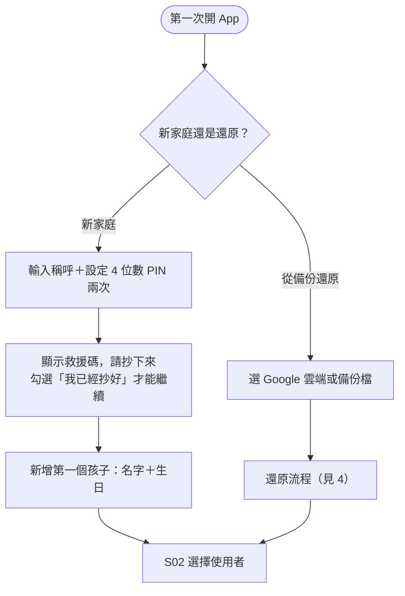
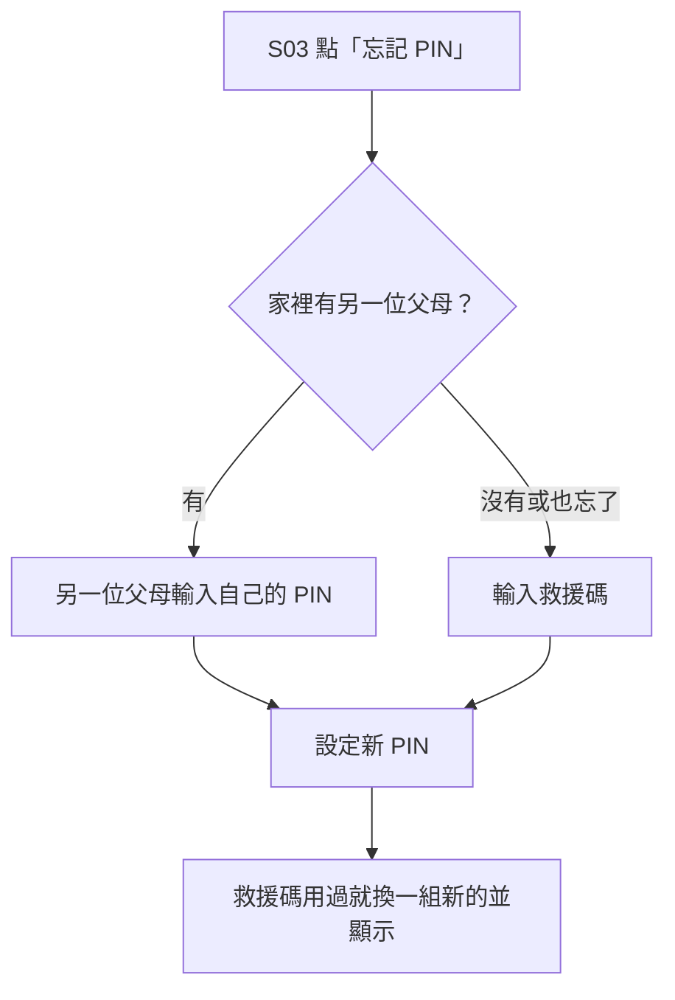
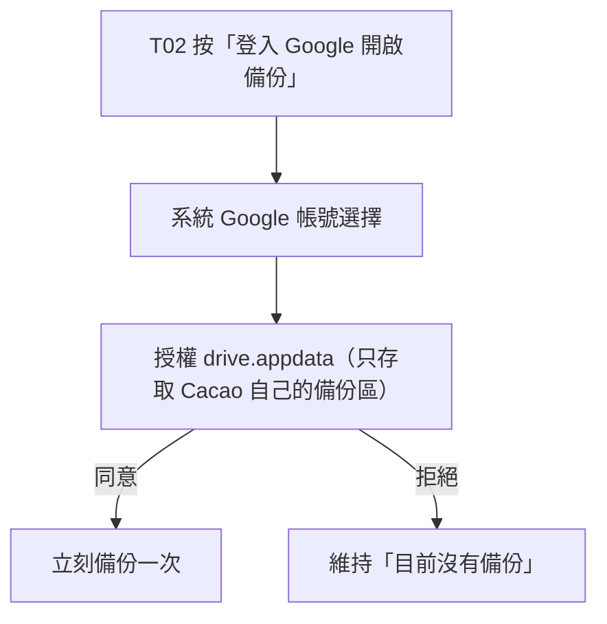
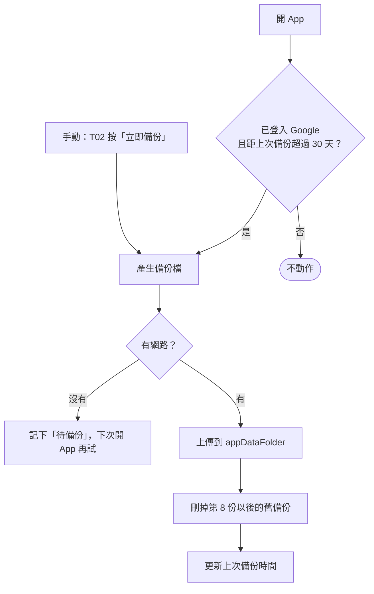
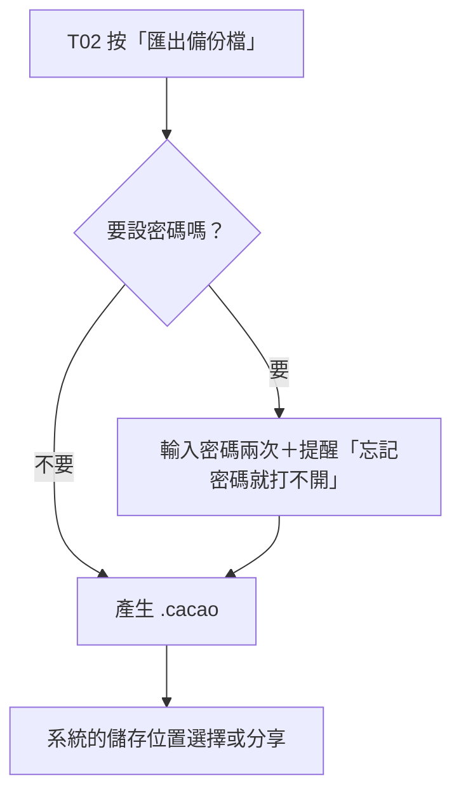
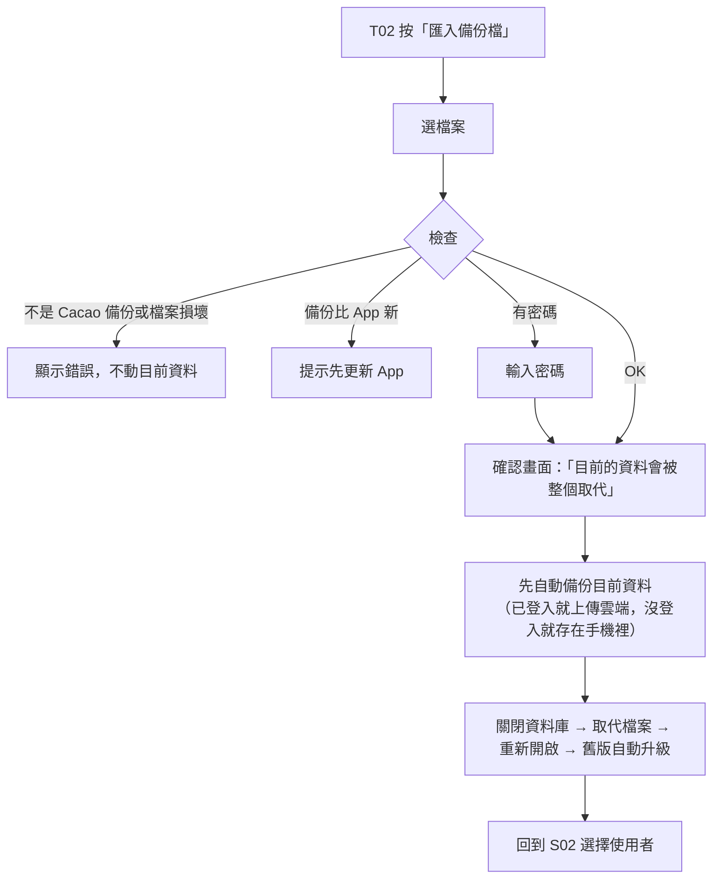
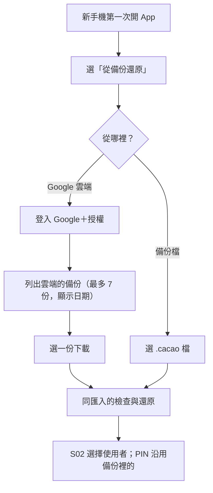

# Cacao — 身分與備份設計

> 狀態：第一版定稿（2026-11-02）。第一版只實作 Android；iOS 在 Phase 2 照同一份規則實作。
> 依據：`docs/product/features.md`（裝置與身分、備份與還原）、`docs/tech-decisions.md`（D-02、D-05～D-08、D-16、D-24）、`docs/design.md`（交給下一階段）、`docs/data-model.md`。

---

## 前提（已定案）

- 完全不用後端，沒有伺服器可以驗證或重設任何東西。
- 不做帳號密碼登入；Google 登入只用於雲端備份，沒登入也能用 App。
- 全家共用一台手機。
- PIN 4 位數，每位父母一組，Argon2id 加鹽雜湊存在資料庫、跟著備份走（D-08）。
- 備份檔就是整個 SQLite 資料庫（D-06）；雲端放 `appDataFolder`、不加密（D-05、D-07）；匯出檔可選擇設密碼。

---

## 1. PIN

### 驗證點

- 從「選擇使用者」點父母 → 進入父母模式。
- 孩子模式角落鎖頭 → 進入父母模式。
- 孩子按任務「完成」→ 父母當場驗收（不通過就取消，任務維持待完成）。
- 修改自己的 PIN（先輸入舊 PIN）、幫另一位父母重設 PIN（輸入自己的 PIN）。
- 設定只在父母模式裡，不另外驗證。

### 第一次開 App

- ⚠ 線框 S01 要補「新家庭／從備份還原」的第一步。

### 輸錯的處理（AI 決定）

- 連續輸錯 5 次 → 等 30 秒；再錯 5 次 → 等 5 分鐘；之後每 5 次都等 5 分鐘。
- 計數存手機偏好設定，輸對就歸零。
- 目的是擋孩子亂猜，不是擋專業破解。

### 忘記 PIN

- **救援碼**：16 個字元，分 4 組（例如 `K7QM-2XRP-9TWD-F4HN`），排除容易看錯的字（0／O、1／I／L）。只在建立時與更換後顯示一次，存 Argon2id 雜湊。
- 每位父母各有一組；可以在「家庭成員」重新產生（要先輸入 PIN）。
- 救援碼也忘了：只能從「這支 PIN 設定之前」的備份還原，或重新開始。建立時要清楚提醒。

### 父母模式什麼時候自動鎖回去（AI 決定）

- App 切到背景超過 1 分鐘，或手機螢幕關掉 → 回到「選擇使用者」。
- 父母主動按「登出父母模式」→ 回到「選擇使用者」。

### 孩子密碼（選填）

- 4 位數，用同一個輸入畫面；輸錯規則同 PIN。
- 孩子在自己的首頁設定或取消；忘記時由父母在「家庭成員」重設，不需要舊密碼。

---

## 2. Google 登入與雲端備份

### 開啟雲端備份

- 只在使用者按下按鈕時才要授權，不在開 App 時跳出來。

### 備份

- 上次備份時間存手機偏好設定（`data-model.md`），不存資料庫。
- 自動備份在背景進行，不擋畫面；失敗只在 T02 顯示，不跳通知（規格不做推播）。

### 登出 Google

- 停用雲端備份；雲端上已有的備份保留，再次登入同一個帳號就看得到。
- T02 與設定改回顯示「目前沒有備份」。

---

## 3. 匯出／匯入備份檔

### 備份檔格式（雲端與匯出共用）

- 副檔名 `.cacao`，內容是 ZIP：
  - `manifest.json`：`formatVersion`、`schemaVersion`（= `PRAGMA user_version`）、`appVersion`、`platform`（android／ios）、`createdAt`、`encrypted`（true／false）。
  - `cacao.db`：`VACUUM INTO` 產生的完整快照；有設密碼時改為 `cacao.db.enc`。
- 兩個平台同一格式，Phase 2 時 Android ↔ iPhone 可以互相還原（D-16）。

### 匯出

- 密碼加密：AES-256-GCM，金鑰由密碼經 Argon2id 產生，鹽與參數寫在 `manifest.json`（D-07）。

### 匯入（整個覆蓋）

- 檢查項目：`manifest.json` 存在、`PRAGMA integrity_check` 通過、`schemaVersion` 不比 App 新。
- 覆蓋前那份「目前資料」的備份，在手機裡保留最近 1 份，可從 T02 還原回來。

---

## 4. 換手機還原

- PIN、救援碼、孩子密碼都在資料庫裡，還原後照舊可用。
- 主題、語言、音效是手機設定，不在備份裡，新手機用預設值。

---

## 5. 安全考量

- **本機資料庫不加密**（D-04）：靠手機本身的螢幕鎖保護。
- **雲端備份不加密**（D-07）：存在使用者自己的 Google 帳號、Cacao 專用的隱藏區域；外人拿不到。
- **PIN 只防孩子**：4 位數 Argon2id 雜湊，但拿到資料庫檔的人仍可離線暴力破解；這是可接受的取捨，因為 PIN 不保護錢，只區分父母與孩子。
- **救援碼**比 PIN 長很多，離線破解不實際。
- **孩子模式能做的事**照 `features.md`〈角色權限〉：看存款與目標、建立／刪除目標、確認已達成、回報任務、記錢包。其他操作都要父母模式。

---

## 6. 實作注意（Android 第一版）

- **Google 授權**：Google Identity Services 的 Authorization API（`play-services-auth`），只請求 `https://www.googleapis.com/auth/drive.appdata`；拿到 access token 後直接呼叫 Drive REST API v3。
- **Argon2id**：Bouncy Castle 的 `Argon2BytesGenerator`；雜湊存成標準 PHC 字串（`$argon2id$v=19$m=…,t=…,p=…$鹽$雜湊`），Phase 2 的 iOS 用 libsodium 也能驗證同一個字串。參數先用 m=19 MiB、t=2、p=1（OWASP 建議值），在低階手機上驗證速度後再調。
- **AES-256-GCM**：系統內建 `javax.crypto`。
- **快照**：`VACUUM INTO` 產生到 App 暫存目錄，壓縮成 `.cacao` 後刪除暫存檔。
- **匯出／匯入**：Storage Access Framework（`ACTION_CREATE_DOCUMENT`／`ACTION_OPEN_DOCUMENT`）＋系統分享。
- **取代資料庫**：先關閉所有連線，再取代檔案並刪除舊的 `-wal`、`-shm`，最後重新開啟跑 migration。
- **Google OAuth 審核**：`drive.appdata` 屬於非敏感範圍，但上架前仍要在 Google Cloud 建立 OAuth 同意畫面並填寫隱私權政策網址。

---

## 設計時的決定（AI 決定，可推翻）

- PIN 輸錯 5 次等 30 秒、再 5 次等 5 分鐘。
- 父母模式在 App 切到背景超過 1 分鐘或螢幕關掉時自動鎖回去。
- 救援碼 16 字元、用過就換新的。
- 匯入覆蓋前的「目前資料」備份在手機裡留最近 1 份。
- 備份檔用 `.cacao`（ZIP＋`manifest.json`），雲端與匯出共用。
