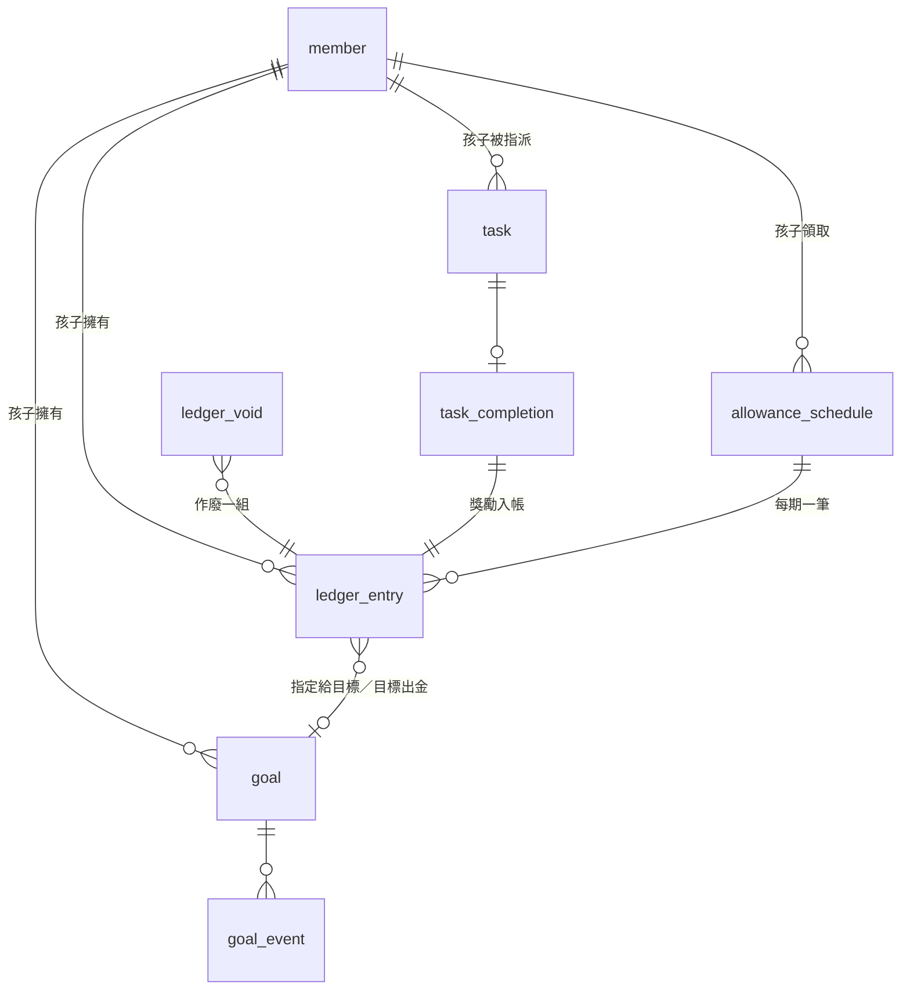

# Cacao — 資料模型

> **Phase 1 定案文件**：本文件內容 P1 已實作 ✅；標「第二版」的段落為 ⏭ 延到 P2。Phase 2 的修改會另外標示，不覆蓋 P1 結論。

> 狀態：第一版定稿（2026-11-01）。
> 依據：`docs/product/features.md`、`docs/data-model-qa.md`（DQ-01～DQ-12）、`docs/design.md`（交給下一階段）、`docs/tech-decisions.md`（D-04～D-08、D-15、D-16）。
> 這份 SQL 之後放進 `shared/db/`，Android（SQLDelight）與 Phase 2 的 iOS（GRDB）共用同一份。

---

## 設計原則（摘要）

- 資料只存手機本機 SQLite；備份就是整個資料庫檔（D-06），所以資料庫只放家庭資料。主題、語言、音效、上次備份時間存手機偏好設定。
- 金錢一律記在**流水帳**，只新增、不修改；記錯用**作廢**（另存一筆作廢紀錄）。
- 存款、錢包、已鎖金額、可出金額、目標進度**全部由紀錄算出**，不存餘額欄位。
- 主鍵 UUID（TEXT、不可為空），不用自動遞增；可修改的資料有 `updated_at`，刪除用 `deleted_at` 軟刪除——為第二版同步預留。
- 金額 INTEGER（新台幣元）；日期 `YYYY-MM-DD`、時間 ISO 8601 UTC 字串。
- 系統產生的類型、狀態存代碼（D-15）；使用者輸入的文字照原文存。

---

## 實體與關係

- **member** 家庭成員：父母、長輩、孩子共用一張表，用 `role` 區分。
- **ledger_entry** 金錢流水帳：每筆屬於一個孩子的一個帳戶（存款或錢包）。
  - 1 個孩子 : N 筆紀錄。
  - 出金是一組兩筆（存款 −X、錢包 +X），用 `group_id` 綁在一起。
- **ledger_void** 作廢紀錄：1 筆作廢 : 1 組紀錄（`group_id`）。
- **goal** 儲蓄目標：1 個孩子 : N 個目標。
- **goal_event** 目標事件：確認達成、退回、完成、修改目標金額；1 個目標 : N 個事件。
- **allowance_schedule** 常態零用錢排程：1 個孩子 : N 個排程；來源是父母或長輩。
- **task** 任務：建立時勾選幾個孩子就產生幾筆，同一次建立的共用 `batch_id`。
- **task_completion** 任務完成：1 個任務 : 0～1 筆完成紀錄（驗收當場寫入，沒有「待驗證」）。



---

## Schema（schema version 1）

```sql
PRAGMA user_version = 1;
PRAGMA foreign_keys = ON;

-- 家庭成員
CREATE TABLE member (
  id              TEXT NOT NULL PRIMARY KEY,
  role            TEXT NOT NULL CHECK (role IN ('parent', 'elder', 'child')),
  name            TEXT NOT NULL,
  birthday        TEXT,                -- 孩子必填（DQ-12），其他角色 NULL
  avatar_color    TEXT NOT NULL,       -- 頭像底色代碼
  pin_hash        TEXT,                -- 父母必填：Argon2id PHC 字串（含鹽，D-08）
  recovery_hash   TEXT,                -- 父母：救援碼的 Argon2id 雜湊
  password_hash   TEXT,                -- 孩子選填密碼（UQ-03）
  sort_order      INTEGER NOT NULL DEFAULT 0,
  created_at      TEXT NOT NULL,
  updated_at      TEXT NOT NULL,
  deleted_at      TEXT,
  CHECK (role <> 'child'  OR birthday IS NOT NULL),
  CHECK (role <> 'parent' OR pin_hash IS NOT NULL)
);

-- 儲蓄目標
CREATE TABLE goal (
  id              TEXT NOT NULL PRIMARY KEY,
  child_id        TEXT NOT NULL REFERENCES member(id),
  name            TEXT NOT NULL,
  target_amount   INTEGER NOT NULL CHECK (target_amount > 0),
  priority        REAL NOT NULL,       -- 越小越優先；拖曳時取前後兩者中間值
  fill_enabled    INTEGER NOT NULL DEFAULT 1 CHECK (fill_enabled IN (0, 1)),
  created_by      TEXT NOT NULL REFERENCES member(id),
  created_at      TEXT NOT NULL,
  updated_at      TEXT NOT NULL,
  deleted_at      TEXT
);
CREATE INDEX goal_child ON goal(child_id, priority);

-- 目標事件（狀態與金額修改的歷史，只新增）
CREATE TABLE goal_event (
  id              TEXT NOT NULL PRIMARY KEY,
  goal_id         TEXT NOT NULL REFERENCES goal(id),
  kind            TEXT NOT NULL CHECK (kind IN ('confirmed', 'reverted', 'completed', 'target_changed')),
  amount          INTEGER,             -- confirmed：鎖住的金額；target_changed：新目標金額
  ledger_group_id TEXT,                -- completed：對應的出金 group_id
  member_id       TEXT NOT NULL REFERENCES member(id),
  created_at      TEXT NOT NULL
);
CREATE INDEX goal_event_goal ON goal_event(goal_id, created_at);

-- 常態零用錢排程
CREATE TABLE allowance_schedule (
  id              TEXT NOT NULL PRIMARY KEY,
  child_id        TEXT NOT NULL REFERENCES member(id),
  source_id       TEXT NOT NULL REFERENCES member(id),   -- 父母或長輩
  amount          INTEGER NOT NULL CHECK (amount > 0),
  period          TEXT NOT NULL CHECK (period IN ('daily', 'weekly', 'biweekly', 'monthly')),
  weekday         INTEGER CHECK (weekday BETWEEN 1 AND 7),   -- weekly／biweekly：1＝週一
  month_day       INTEGER CHECK (month_day BETWEEN 1 AND 31), -- monthly；小月份在月底發
  active_from     TEXT NOT NULL,       -- 開始或恢復發放的日期；biweekly 以此為基準週
  paused          INTEGER NOT NULL DEFAULT 0 CHECK (paused IN (0, 1)),
  created_at      TEXT NOT NULL,
  updated_at      TEXT NOT NULL,
  deleted_at      TEXT
);

-- 任務（每個孩子一筆）
CREATE TABLE task (
  id              TEXT NOT NULL PRIMARY KEY,
  batch_id        TEXT NOT NULL,       -- 同一次建立給多個孩子
  child_id        TEXT NOT NULL REFERENCES member(id),
  title           TEXT NOT NULL,
  reward_amount   INTEGER NOT NULL CHECK (reward_amount > 0),
  issuer_id       TEXT NOT NULL REFERENCES member(id),   -- 出題人：父母或長輩
  created_by      TEXT NOT NULL REFERENCES member(id),
  created_at      TEXT NOT NULL,
  updated_at      TEXT NOT NULL,
  deleted_at      TEXT
);
CREATE INDEX task_child ON task(child_id);

-- 金錢流水帳（只新增）
CREATE TABLE ledger_entry (
  id              TEXT NOT NULL PRIMARY KEY,
  group_id        TEXT NOT NULL,       -- 同一次操作的多筆共用；單筆時等於 id
  child_id        TEXT NOT NULL REFERENCES member(id),
  account         TEXT NOT NULL CHECK (account IN ('savings', 'wallet')),
  kind            TEXT NOT NULL CHECK (kind IN (
                    'income_onetime',     -- 一次性收入（紅包、生日…）
                    'income_allowance',   -- 常態零用錢
                    'income_task',        -- 任務獎勵
                    'payout',             -- 出金（存款 −、錢包 + 各一筆）
                    'wallet_expense',     -- 錢包支出
                    'wallet_adjustment'   -- 校正餘額的差額（未記錄支出）
                  )),
  amount          INTEGER NOT NULL CHECK (amount <> 0),   -- 有正負：對該帳戶的增減
  occurred_on     TEXT NOT NULL,       -- 發生日；零用錢補記用原本到期日
  source_id       TEXT REFERENCES member(id),   -- 收入來源：父母或長輩
  goal_id         TEXT REFERENCES goal(id),     -- 收入：指定給目標；出金：關聯的已達成目標
  note            TEXT,                -- 說明（使用者輸入）
  message         TEXT,                -- 長輩的一句話（使用者輸入）
  allowance_id    TEXT REFERENCES allowance_schedule(id),
  allowance_due   TEXT,                -- 零用錢這期的到期日
  recorded_by     TEXT REFERENCES member(id),   -- 記帳的人；孩子自己記錢包時是孩子
  created_at      TEXT NOT NULL,
  UNIQUE (allowance_id, allowance_due)          -- 補記不會重複發
);
CREATE INDEX ledger_child ON ledger_entry(child_id, account, occurred_on);
CREATE INDEX ledger_group ON ledger_entry(group_id);
CREATE INDEX ledger_goal ON ledger_entry(goal_id);

-- 作廢（只新增；作廢一整組）
CREATE TABLE ledger_void (
  id              TEXT NOT NULL PRIMARY KEY,
  group_id        TEXT NOT NULL UNIQUE,
  voided_by       TEXT NOT NULL REFERENCES member(id),
  created_at      TEXT NOT NULL
);

-- 任務完成（驗收當場寫入）
CREATE TABLE task_completion (
  id              TEXT NOT NULL PRIMARY KEY,
  task_id         TEXT NOT NULL UNIQUE REFERENCES task(id),
  verified_by     TEXT NOT NULL REFERENCES member(id),   -- 驗收的父母
  ledger_group_id TEXT NOT NULL,                         -- 獎勵那筆紀錄
  completed_at    TEXT NOT NULL
);
```

- 「有效紀錄」＝ `group_id` 不在 `ledger_void` 的紀錄。以下計算都只算有效紀錄。
- 任務獎勵那筆紀錄 `source_id` = 任務的出題人，畫面才能顯示「爺爺給你 50」。
- 長輩塞現金、現金留在孩子手上：一組三筆——收入（存款 +）、出金（存款 −、錢包 +），共用 `group_id`。

---

## Migration

- 規則：`shared/db/001_init.sql` 是 v1 初始 schema，之後每個版本一個 `NNN_*.sql`，只寫升級語句。Android 由 SQLDelight 轉成 `.sqm`，新安裝的建表寫在 `sqldelight/*.sq`，兩邊要一致。舊版備份匯入後，開 App 時自動升級。
- **v2（`002_task_proposal.sql`，Phase 2）**：新增 `task_proposal` 孩子提議任務（discover WD-35）。孩子新增的任務是 0 元，先放這張表；父母設定金額後轉成正式 `task`（`created_by` 是孩子），提議軟刪除。不改 `task.reward_amount > 0` 的限制，所以 0 元提議不能「完成」，要先設金額。
- **v3（`003_elder_side.sql`，Phase 2）**：新增 `elder_side`（`elder_id` → `parent_id`），記錄長輩是哪位父母這邊的（discover WD-41）：哪位父母登入時新增的長輩，就算那位父母這邊的。給之後的金錢貢獻報表用，「誰給的」選單不過濾。升級時只有一位父母的家庭，舊長輩直接分給他；兩位父母的，舊長輩先不分，在家庭成員頁按「算我這邊」。

## 推算規則

### 餘額

- **存款** = 該孩子 `account = 'savings'` 有效紀錄的 `amount` 加總。
- **錢包** = `account = 'wallet'` 有效紀錄加總。
- **目標狀態**：看該目標最後一個 `confirmed`／`reverted`／`completed` 事件——
  - `completed` 且對應出金未作廢 → 已完成。
  - `completed` 但對應出金已作廢 → 回到已達成（DQ-07）。
  - `confirmed` → 已達成；`reverted` 或沒有事件 → 進行中（或計算出的可達成）。
- **已鎖金額** = 所有「已達成」目標的鎖定金額加總（`confirmed` 事件的 `amount`，即當時的目標金額）。
- **指定額**：每個「進行中」目標（未刪除）的指定額 = min(指定給它的有效收入加總, 目標金額)，超過的部分回到池子（DQ-04）。已達成的目標改算鎖定金額，不重複計算。
- **可出金額** = 存款 − 已鎖金額 − 指定額加總；最低 0，出金不能超過（DQ-02、DQ-13）。

### 瀑布填充（只算「進行中」的目標，未刪除）

1. 池子 = 可出金額（已經扣掉鎖定與指定的錢）。
2. **指定的錢**直接算給該目標，不從池子拿。
3. **一般填充**：依優先順序，只算 `fill_enabled = 1` 的目標，每個拿 min(目標金額 − 指定額, 池子剩下的)。
4. 指定額＋填充額 ≥ 目標金額 → 顯示「可達成」；之後存款變少不夠時自動回到進行中（DQ-06）。
5. 孩子確認時寫 `confirmed` 事件，`amount` = 當時的目標金額，從此算在已鎖金額裡。

### 目標出金

- 從已達成的目標出金：寫一組 `payout` 紀錄（`goal_id` = 該目標）＋ `completed` 事件。
- 實際金額低於目標（特價）：目標變已完成後不再鎖錢，剩下的自動回到池子。
- 實際金額高於目標：先由孩子退回進行中、修改目標金額（`reverted`＋`target_changed`）。

### 常態零用錢補記

- 開 App 時、以及**修改或暫停排程之前**，先把每個未暫停排程從 `active_from` 到今天的到期日逐筆補記；`(allowance_id, allowance_due)` 唯一，不會重複。
- 每月 29～31 號遇到小月份 → 當月最後一天。
- 暫停期間不補發：恢復時把 `active_from` 設為恢復當天。

### 成長紀錄（簡單版）

- 依孩子生日切出「N 歲這一年」的日期區間。
- 存了多少 = 區間內有效的 `income_*` 紀錄加總；完成任務 = 區間內 `task_completion` 筆數。

---

## 不放進資料庫的設定

存手機偏好設定（Android DataStore；Phase 2 iOS UserDefaults），不進備份：

- 主題、語言、音效開關
- 上次備份時間（放資料庫會在還原時被舊值蓋掉）

---

## 第二版同步預留

- **流水帳聯集**：`ledger_entry`、`ledger_void`、`goal_event`、`task_completion` 只新增、主鍵 UUID，兩台手機的資料直接依 UUID 合併。
- **可修改資料以最後修改為準**：`member`、`goal`、`allowance_schedule`、`task` 有 `updated_at` 與 `deleted_at`。
- **cr-sqlite**：所有表都有非空主鍵、沒有自動遞增，符合它的要求；`UNIQUE (allowance_id, allowance_due)` 可避免兩台手機重複補記同一期零用錢。

---

## 設計時的決定（AI 決定，可推翻）

- **作廢以「一組」為單位**：出金的兩筆、長輩塞現金的三筆會一起作廢。理由是記錯的那次操作「沒有發生過」，存款扣的與錢包加的是同一件事的兩面，要一起撤銷。這跟錢包對不對得上無關：錢包本來就不需要對上實際現金，孩子沒記帳時用「校正餘額」手動平帳是正常行為（2026-11-02 使用者指正）。
- **修改零用錢排程前先補記**：保證過去的期數用舊金額、之後才用新金額（「之後照新金額發」）。
- **上次備份時間存手機偏好設定**：避免還原後被舊值蓋掉，導致「超過 30 天自動備份」判斷錯誤。
- **成員共用一張表**：父母、長輩、孩子都可能是收入來源或出題人，同一張表讓外鍵簡單。
