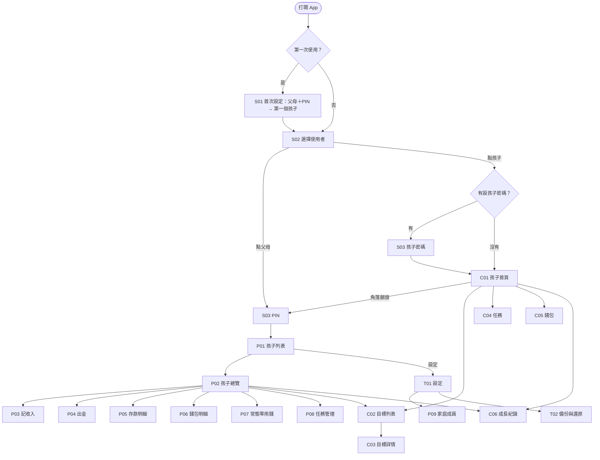
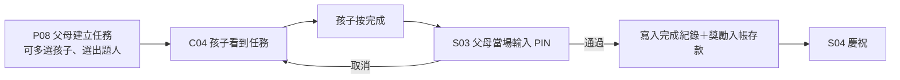
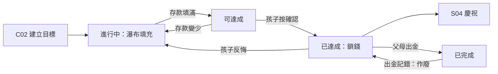
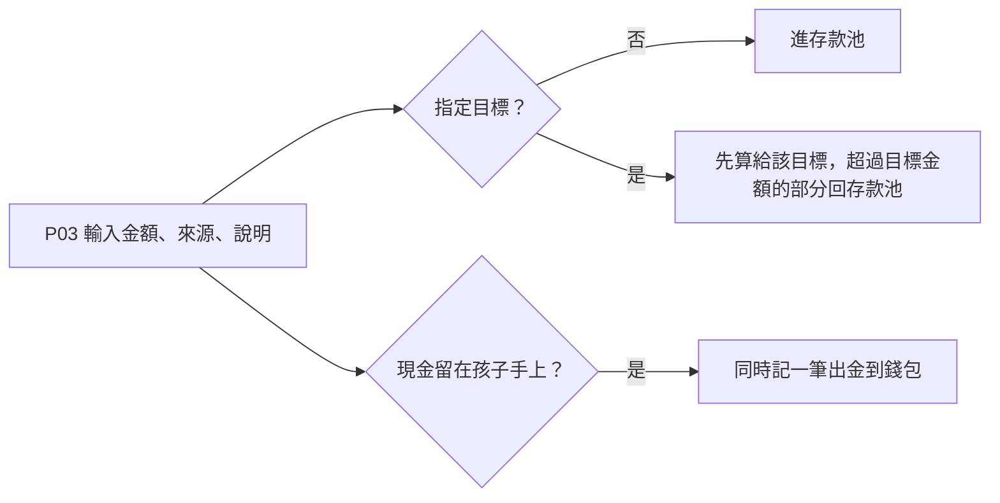
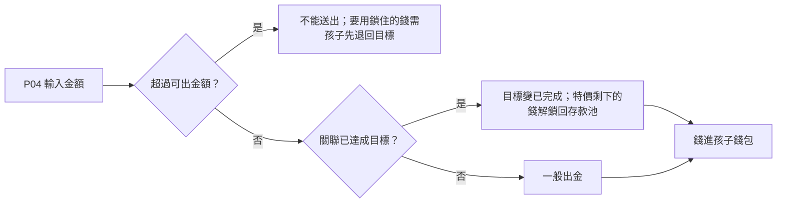
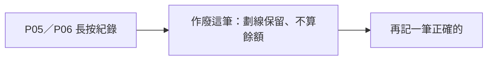
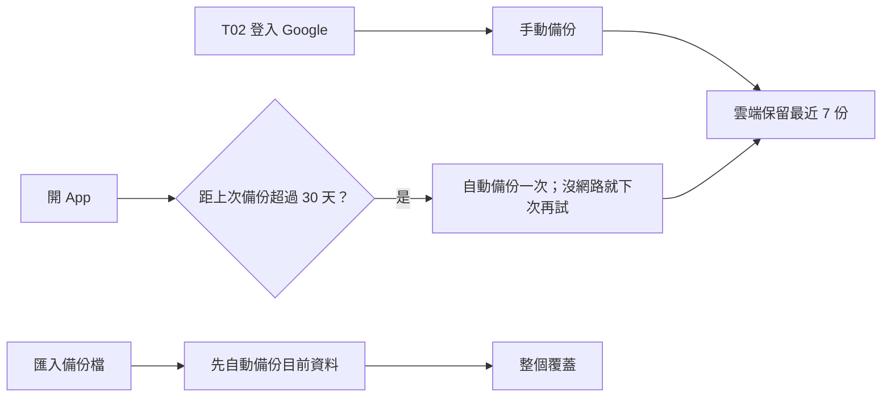

# Cacao — UI/UX 設計

> 狀態：完成（2026-11-01）。畫面清單、導覽結構、主要流程、21 個線框、交給下一階段的清單都已完成；UQ-01～UQ-09 已定案。
> 來源：`docs/product/features.md`、`docs/product/overview.md`、`docs/data-model-qa.md`。
> 線框畫布（21 個畫面）：<https://claude.ai/artifact/1hViDqnAG3cSEF4oLbudGg>。孩子模式用首頁大方塊選單導覽（UQ-09）。

---

## 畫面清單

### 共用

- **S01 首次設定引導**：第一次開 App；建立第一位父母與 PIN、新增第一個孩子（名字＋生日）。
- **S02 選擇使用者**：每次打開 App 的第一個畫面（UQ-01）；選父母要輸入 PIN，選孩子時該孩子有設密碼才要輸入（UQ-03）。
- **S03 PIN 輸入**：彈出式；進入父母模式、任務驗收、父母限定操作時出現；孩子密碼也共用這個畫面。
- **S04 慶祝**：彈出式動畫；目標確認「已達成」、任務驗收通過時播放。

### 父母模式

- **P01 孩子列表**：選要管理的孩子；每個孩子顯示存款、錢包餘額摘要。
- **P02 孩子總覽**：該孩子的存款、已鎖金額、可出金額、錢包餘額，以及目標（共用 C02／C03，多「出金」按鈕，UQ-05）、任務、明細、成長紀錄（共用 C06，UQ-06）的入口。
- **P03 記收入**：類型（一次性／父母加碼）、來源（父母或某位長輩）、金額、一句話、指定目標、「現金留在孩子手上」選項。
- **P04 出金**：金額（上限為可出金額）、可選關聯一個「已達成」的目標。
- **P05 存款明細**：流水帳列表；可作廢某筆紀錄。
- **P06 錢包明細（父母）**：查看、修正孩子的錢包紀錄，校正餘額。
- **P07 常態零用錢**：每個孩子的排程列表；新增、修改金額與週期、暫停；來源可為父母或長輩。
- **P08 任務管理**：任務列表；建立任務（名稱、獎勵、出題人、可多選孩子）、刪除。
- **P09 家庭成員**：父母（含 PIN 修改）、長輩、孩子的新增與編輯；清除或重設孩子密碼（UQ-07）。

### 孩子模式

幼兒、童年、青少年共用同一套孩子畫面（UQ-04）。

- **C01 孩子首頁**：上半部存款、錢包餘額、最近收到的錢（「爺爺給你 500」卡片）；下半部 4 個大方塊進入目標、任務、錢包、成長（UQ-09）；角落 🔒 → PIN 切回父母模式（UQ-02）；可設定或取消自己的密碼（UQ-03）。
- **C02 目標列表**：瀑布填充進度、拖曳排序、勾選是否參與填充、新增目標。
- **C03 目標詳情**：進度、狀態；「可達成」時確認（只在孩子模式）、「已達成」時退回、修改目標金額、刪除；父母模式多「出金」按鈕。
- **C04 任務列表**：待完成任務；按「完成」→ S03 PIN 當場驗收。
- **C05 錢包**：錢包餘額與支出紀錄；記一筆支出、校正餘額。
- **C06 成長紀錄**：一年累計存了多少、完成幾個任務。

### 設定（父母限定）

- **T01 設定首頁**：主題、語言、備份、家庭成員入口。
- **T02 備份與還原**：Google 登入、雲端備份狀態（沒登入時提醒「目前沒有備份」）、匯出／匯入備份檔、從備份還原。

---

## 導覽結構

- 孩子模式的子畫面左上角「‹」回 C01；父母模式的子畫面「‹」回上一層。
- 只有父母模式能進設定。

## 主要流程

### 任務驗收

### 儲蓄目標

### 記收入（含長輩、指定目標）

### 出金

### 更正記錯的帳

### 備份

---

## 交給下一階段

### `/data-model` 需要支援

- 存款明細：依日期列出收入、出金、任務獎勵、零用錢，含來源（父母或某位長輩）、說明、長輩的一句話、作廢狀態。
- 首頁與總覽：存款、已鎖金額、可出金額、錢包餘額（全由流水帳算出）。
- 目標列表：優先順序、是否參與填充、指定給該目標的金額、狀態（已達成／已完成存紀錄，可達成由計算得出）。
- 任務：出題人、給哪個孩子、完成紀錄（驗收的父母、時間）。
- 常態零用錢：來源、金額、週期（每天／每週／每兩週／每月）、星期幾或幾號、暫停。
- 成長紀錄：依孩子生日切年齡的一年累計存款與完成任務數。
- 家庭成員：父母（PIN 雜湊、救援碼雜湊）、長輩、孩子（生日、選填密碼雜湊）。
- 備份：上次備份時間（存手機偏好設定還是資料庫，由 `/data-model` 決定）。

### `/auth-design` 需要處理

- PIN 驗證點：進入父母模式、任務驗收、修改／重設 PIN、孩子密碼（選填）。
- 忘記 PIN：另一位父母重設；只有一位父母時用救援碼。
- Google 登入入口只在 T02；沒登入時設定與 T02 顯示「目前沒有備份」。
- 手動備份、超過 30 天自動備份、雲端留 7 份、匯入整個覆蓋前先自動備份。
